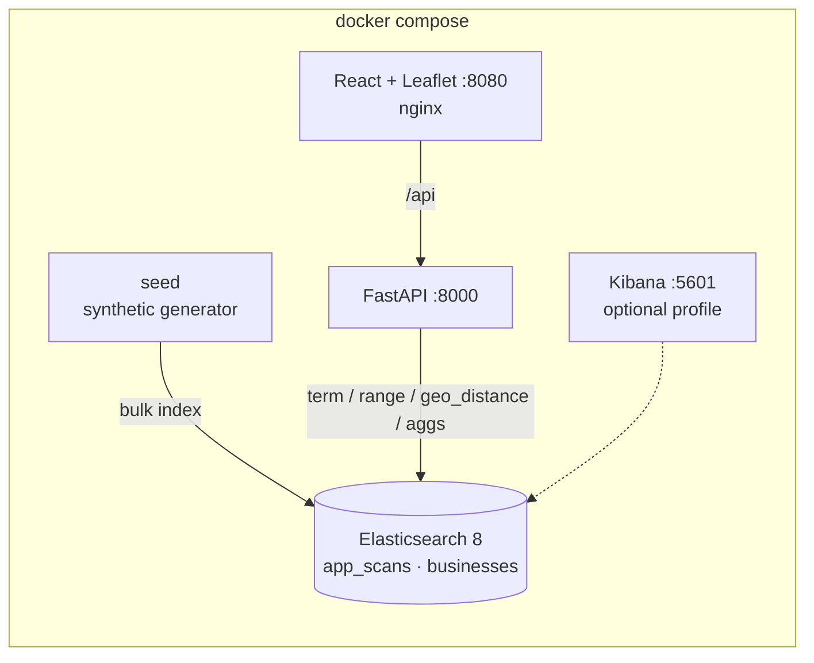
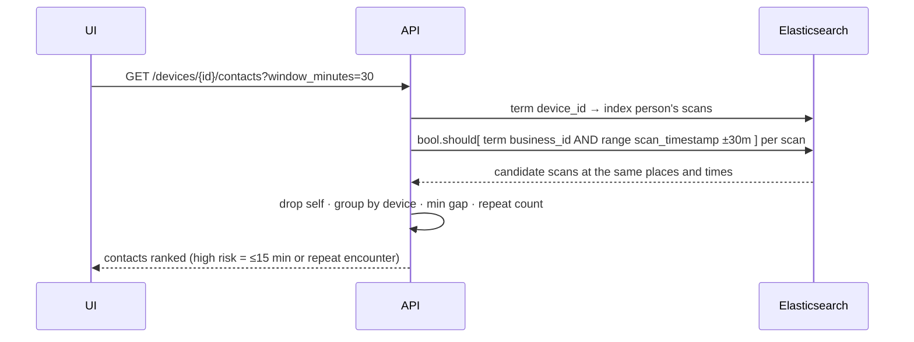

# 🧬 SF App-Scan Contact Tracer

<p align="center"></p>

> Trace people's movements through app check-ins at San Francisco businesses, and find who they were in contact with.
> Built on **Elasticsearch** (geo points, time-range and full-text queries) with a **FastAPI** API and a **React + Leaflet** UI.
> One `docker compose up`.

> ⚠️ **All data is synthetic.** Every person, device ID, business and scan is generated by `tracer/synthetic.py` (Faker, fixed seed). Device IDs use a `555` prefix, and names and businesses are fictional. Only the SF zip-code centres are real public geography. The UI, `/health` and every document (`synthetic: true`) carry this label.


---

## 1. The problem

Someone tests positive. **Where were they, and who scanned into the same places at about the same time?** This is a natural fit for a search engine: filter by device, then by business and time window, then rank. Elasticsearch does this in milliseconds, and it indexes the geo coordinates for map and distance queries.

## 2. Architecture

<p align="center"></p>



## 3. How contact tracing works



## 4. Run it

```bash
cp .env.example .env            # optional: dataset size, ports
docker compose up --build       # UI http://localhost:8080 · API http://localhost:8000/docs
docker compose --profile kibana up -d kibana   # optional Kibana on :5601
RESEED=1 docker compose up -d seed             # regenerate the dataset
docker compose down                            # -v also removes the index volume
```

## 5. The UI

**Trace a device.** Pick a device. You get its path on the map, a timeline in San Francisco time, and the contacts table. Places where a contact happened are red. Drag the window slider (±5–120 min) to widen or narrow the trace. Click a contact to trace them next (second-degree tracing).

**Businesses.** Free-text search (name, category, street, neighbourhood) plus a zip filter, shown on the map. Click a business to see every scan.


**Overview.** Elasticsearch aggregations: scans per neighbourhood and per hour.


## 6. API

| Method | Path | ES feature |
|---|---|---|
| GET | `/health` | ping + dataset metadata (`mode: synthetic`) |
| GET | `/api/businesses?q=&zip=` | `simple_query_string` + `term` |
| GET | `/api/businesses/nearby?lat=&lon=&km=` | `geo_distance` filter + distance sort |
| GET | `/api/businesses/{id}/scans` | `term`, sorted by time |
| GET | `/api/devices` | `terms` agg (most active devices) |
| GET | `/api/devices/{id}/scans` | device trace |
| GET | `/api/devices/{id}/contacts?window_minutes=` | time-window contact tracing |
| GET | `/api/stats` | `terms`, `date_histogram`, `cardinality` aggs |


## 7. What changed from the original

- **Streamlit → FastAPI + React.** The old `app.py`, `src/helpers.py` and `data_generation/` scripts are kept in `legacy/`.
- **Data:** the original joined real DataSF business records with Faker people. This version is fully synthetic and generated at start-up, so no Kaggle download is needed.
- **Mapping:** explicit types (`date`, `keyword`, `geo_point`). The old version stored epochs and divided by `1e12`/`1e9` in the UI to recover dates.
- **New: real contact tracing** (same place ± time window). The original only searched by device or business separately.
- **Elasticsearch 7.17 → 8.15.** Security stays disabled for local use, as in the original. Kibana moved to an optional profile, and there's a healthcheck plus a one-shot seeder (replacing `elasticsearch_loader`).
- `requirements.txt` was replaced by uv with `pyproject.toml` and `uv.lock`. The original README and images are in [docs/ORIGINAL_README.md](docs/ORIGINAL_README.md).

## 8. Quality

- `uv run pytest`: contact-window logic (inside/outside window, self-exclusion, repeat ranking), deterministic, labelled synthetic data inside SF, and the API query shape and validation against a fake ES. No Elasticsearch needed.
- CI: tests, then the frontend build, then `docker compose build`.
- `uv run --no-project --with playwright python scripts/screenshots.py` regenerates the screenshots from the running stack.
